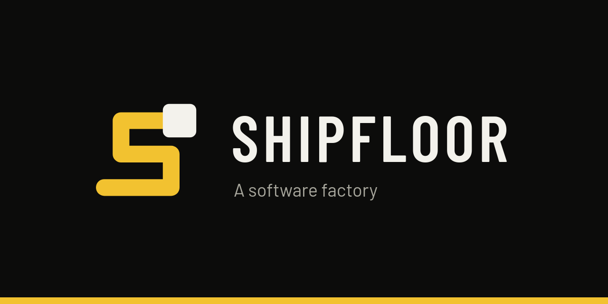
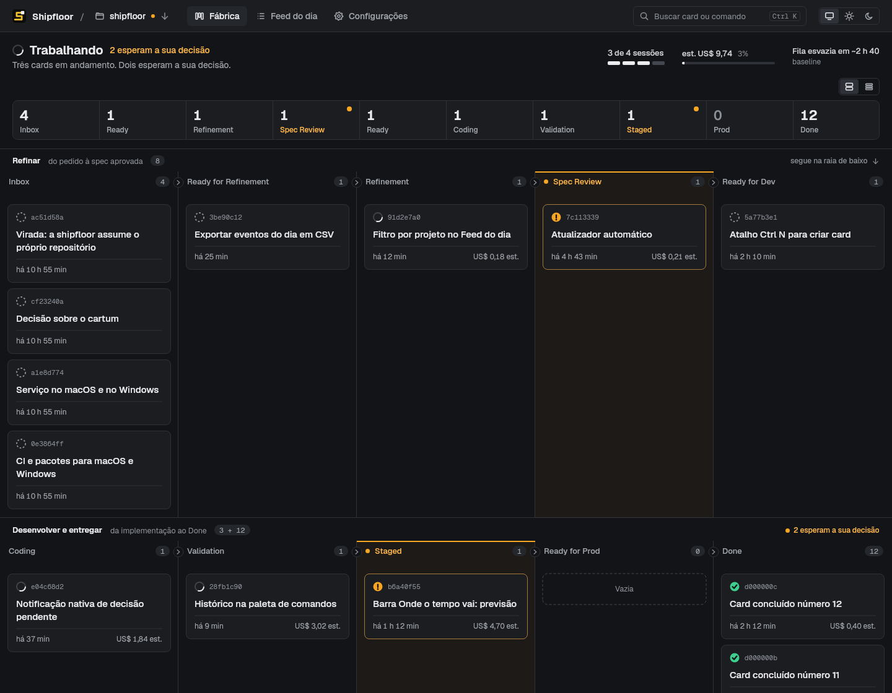
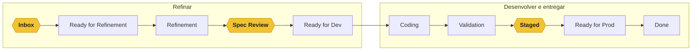
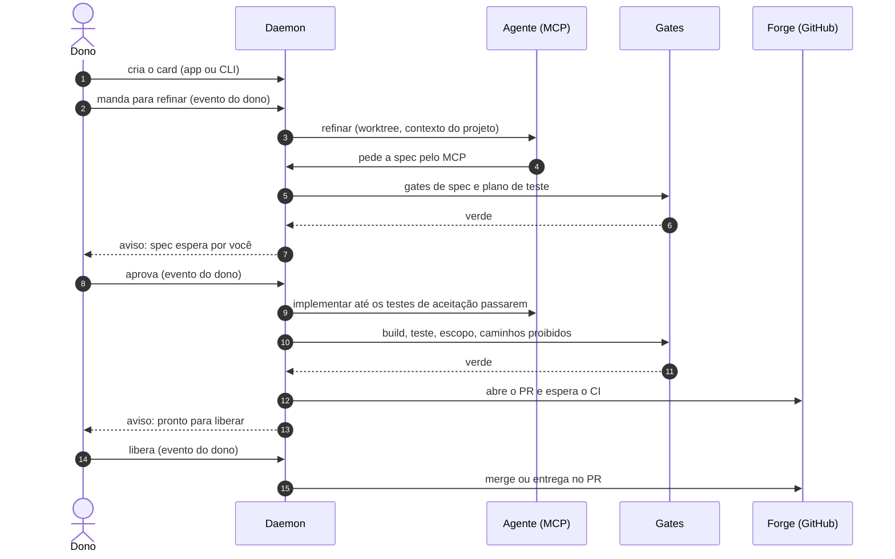
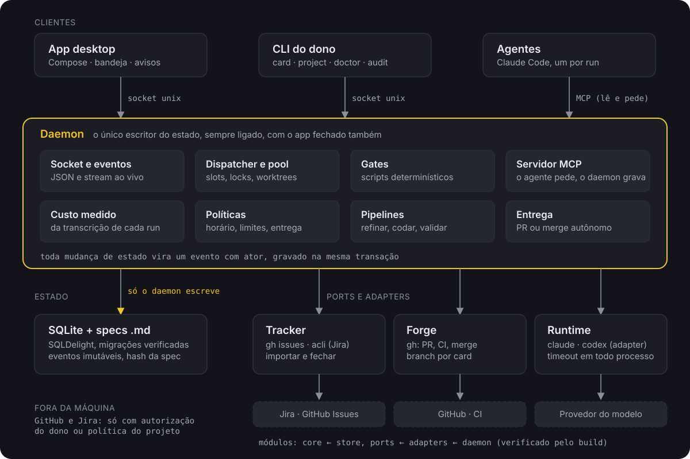
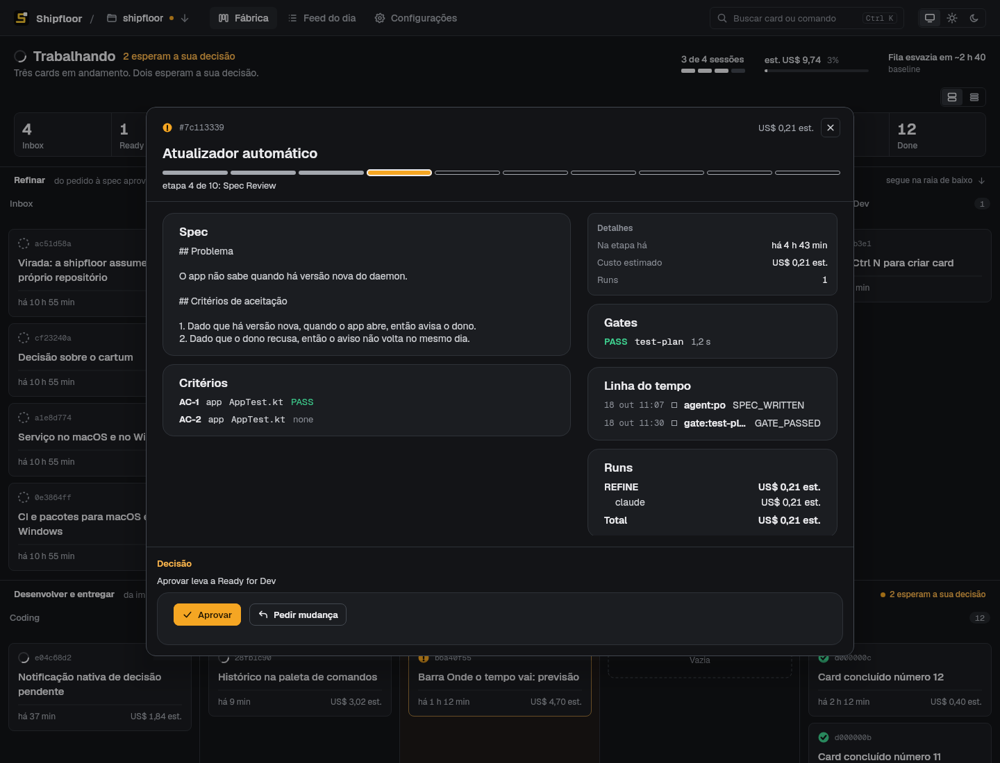
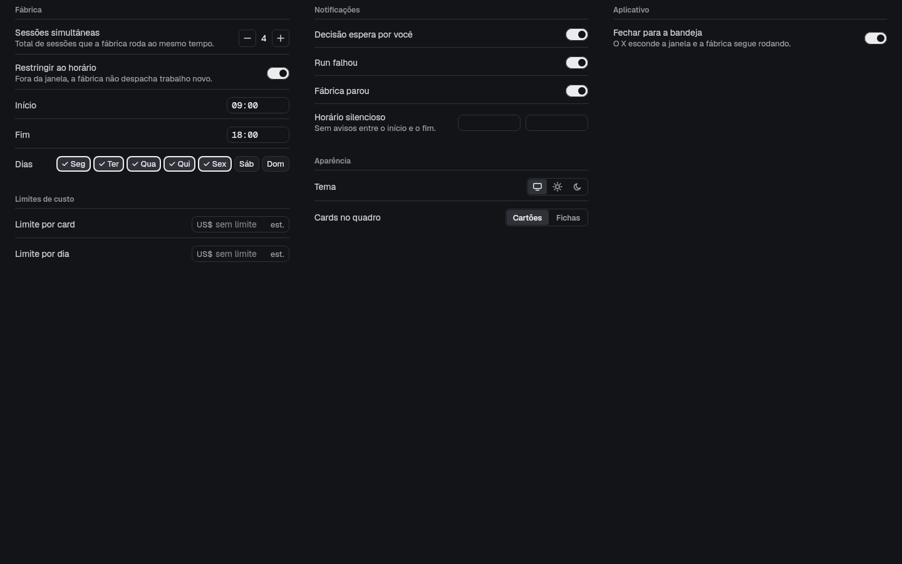

<div align="center">



# Shipfloor

**Uma squad de agentes de código para cada desenvolvedor, rodando na sua máquina.**

Agentes refinam, implementam, validam e entregam. Gates determinísticos seguram a qualidade. Você aparece só onde a decisão é sua: o que entra na fábrica, a spec e a entrega.

[](https://github.com/kennedykjj/shipfloor/actions/workflows/ci.yml)


[Como funciona](#como-funciona) · [Arquitetura](#arquitetura) · [Começando](#começando) · [Estado do projeto](#estado-do-projeto) · [Documentação](#documentação)

</div>

<br>

<p align="center">
  <picture>
    <source media="(prefers-color-scheme: light)" srcset="docs/img/screens/board-light.png">
    
  </picture>
</p>
<p align="center"><sub>O quadro: duas raias, dez colunas. Âmbar marca só o que espera por você. Capturas geradas com dados de exemplo.</sub></p>

## Por que existe

Quem toca muitos projetos sozinho, ou trabalha numa empresa com revisores e Jira, passa o dia entre contexto, spec, código, teste e PR. Agentes de código já fazem boa parte disso. Falta uma linha de montagem em volta deles: quem pode mover o quê, o que prova que um passo terminou, quanto custou e onde o humano decide.

O Shipfloor é essa linha de montagem. Um daemon na sua máquina move cada card por dez colunas, chama o Claude Code em worktrees isoladas e só avança quando um gate passa. Gate é um script, e a palavra do agente não conta. Você recebe um aviso quando há spec para aprovar ou entrega para liberar. O resto roda sozinho, com o app fechado, dentro da janela de horário que você definir.

Ele nasceu para tirar o estado da fábrica da rede. A primeira versão guardava cada card num GitHub Project e estourou a cota de GraphQL. Aqui o card mora num SQLite local, e GitHub e Jira são tocados na importação, em marcos opcionais, no fechamento confirmado e na entrega (branch, PR, CI e merge pela Forge) ([a história completa](docs/context/decisions.md)).

## Como funciona

Um card entra no Inbox e percorre duas raias. Você decide em três pontos: tirar o card do Inbox, aprovar a spec e liberar a entrega.



| Raia | O que acontece | Quem faz |
|---|---|---|
| **Inbox** | você escolhe o que entra na fábrica e manda o card para refinar | **você** |
| Refinar | PO, UX/UI e segurança escrevem a spec; o tech lead monta arquitetura e plano de teste | agentes |
| **Spec Review** | você lê a spec e aprova ou pede mudança | **você** |
| Desenvolver | a QA escreve os testes de aceitação e prova que falham pelo motivo certo; cada camada implementa até eles passarem | agentes |
| Validar | os gates rodam de novo, o código é revisado, o PR é aberto e o CI esperado | fábrica e agentes |
| **Staged** | você libera a entrega | **você** |
| Entregar | a fábrica mergeia (modo autônomo) ou para no PR para a revisão humana (modo entrega no PR) | fábrica |

O modo de entrega é definido por projeto: autônomo para projetos pessoais, entrega no PR para empresas com revisores obrigatórios.

### O que a torna confiável

- **Gates são scripts.** Escopo, caminhos proibidos, build e teste por camada, plano de teste da spec e edição indevida de teste de aceitação são código determinístico, com teste próprio. O relato de um agente nunca move um card.
- **Agente sem shell.** O agente lê o worktree só com `Read`, `Glob` e `Grep` e escreve só pelas ferramentas MCP do daemon, cada escrita dentro do escopo do papel: a QA grava testes, o engenheiro grava a própria camada, qualquer outro caminho é recusado. Ele não roda `git`, `gh` nem comando algum.
- **Custo medido.** Cada run tem o custo calculado a partir da transcrição, contra uma tabela de preços, e aparece como estimativa. Há limite por card e por dia, e por padrão o dispatcher só sobe com um teto de custo configurado.
- **Toda ação é um evento com ator.** Dono, agente (com papel), adaptador (com provedor) ou fábrica (com componente). O evento é gravado na mesma transação da mudança e nunca é alterado. A sua aprovação é um evento do dono, provado pelo token dele (`owner.token`), e nunca um comentário numa issue.
- **Texto de fora é dado.** Issue, ticket e comentário entram por uma porta só, marcados como não confiáveis, e chegam ao agente como dado.
- **Nada sai da máquina sem a sua autorização.** Push, PR e merge exigem um evento do dono ou uma política explícita do projeto que dispense a aprovação.

### A vida de um card



## Arquitetura

<p align="center">
  
</p>

Um **daemon por máquina**, sempre ligado, é o único escritor do estado. App, CLI e agentes são clientes: o app e a CLI falam com ele por socket unix local, os agentes por [MCP](https://modelcontextprotocol.io). O agente lê e pede, e quem decide e grava é o daemon.

| Módulo | Responsabilidade | Pode depender de |
|---|---|---|
| [`core`](core) | Domínio puro: card, colunas, regras de movimento, evento e ator, políticas. Sem IO. | nada |
| [`store`](store) | SQLite (SQLDelight), migrações verificadas, specs em Markdown com hash | `core` |
| [`ports`](ports) | Interfaces `Tracker`, `Forge`, `Runtime` e um fake de cada | `core` |
| [`adapters`](adapters) | `gh`, `acli`, `claude`, `codex`; todo processo externo com timeout | `core`, `ports` |
| [`daemon`](daemon) | Dispatcher, pool, locks, gates, custo, políticas, socket, servidor MCP | `core`, `store`, `ports`, `adapters` |
| [`cli`](cli) | Cliente fino do socket; não lê o banco | `core` |
| [`app`](app) | Compose Desktop; cliente do socket; não lê o banco | `core` |
| [`e2e`](e2e) | Critérios de saída de cada fase, caixa-preta contra daemon e CLI | todos, menos `app` |

A tabela é verificada pelo build: uma dependência fora dela falha a configuração do Gradle. Toda integração externa fica atrás de uma port e tem um fake, então a suíte inteira roda sem rede e sem token. As dez regras que valem em todo o código, e as decisões por trás delas, estão em [ARCHITECTURE.md](ARCHITECTURE.md) e em [docs/context/decisions.md](docs/context/decisions.md).

Hoje só o runtime do **Claude Code** está ligado ao dispatcher. O adapter do Codex existe e tem teste, mas ainda não é escolhido pelo daemon.

## O app

O app é onde o dono mora: o quadro para ver onde cada card está, uma janela larga por card, o feed do dia e as configurações da fábrica. Ele fica residente na bandeja, avisa quando algo espera por você e é só um cliente do daemon, que continua trabalhando com o app fechado. Com mais de um projeto registrado, um seletor ao lado da marca troca o projeto do quadro.

<table>
  <tr>
    <td width="50%">
      <picture>
        <source media="(prefers-color-scheme: light)" srcset="docs/img/screens/card-light.png">
        
      </picture>
    </td>
    <td width="50%">
      <picture>
        <source media="(prefers-color-scheme: light)" srcset="docs/img/screens/settings-light.png">
        
      </picture>
    </td>
  </tr>
  <tr>
    <td align="center"><sub>Um card: a spec, os critérios com o resultado dos gates, a linha do tempo e a decisão.</sub></td>
    <td align="center"><sub>Configurações: sessões simultâneas, horário de trabalho, limites de custo e avisos.</sub></td>
  </tr>
</table>

Tema escuro e claro, com o âmbar reservado ao que espera pela sua decisão. O desenho, os tokens e as regras de interface estão em [DESIGN.md](DESIGN.md).

## Começando

Hoje o Shipfloor roda em **Linux** (testado em Fedora com GNOME e Wayland). macOS e Windows estão no roadmap.

Você precisa de `git`, de `gh` autenticado, da CLI do `claude` já logada e, no projeto que a fábrica vai tocar, de um remote no GitHub. Java: o Gradle inicia com qualquer JDK 17+ e baixa sozinho o JDK 25 da compilação, mas o daemon roda com a JVM que o serviço enxergar, e ela precisa ser a 21 ou mais nova (defina `JAVA_HOME` no `service.env` se o `java` do sistema for mais antigo).

```bash
git clone https://github.com/kennedykjj/shipfloor.git && cd shipfloor

# 1. compila e roda todos os testes
./gradlew build

# 2. instala o daemon e a CLI
./gradlew :daemon:installDist :cli:installDist

# 3. liga o daemon como serviço de usuário do systemd
daemon/build/install/shipfloor-daemon/bin/shipfloor-daemon service install

# 4. põe a CLI no PATH e confere a máquina (java, git, gh, claude, socket, banco, serviço, permissões)
export PATH="$PWD/cli/build/install/shipfloor/bin:$PATH"
shipfloor doctor
```

O serviço executa o daemon direto de `daemon/build/install/`, então um `./gradlew clean` o derruba até a próxima instalação.

O dispatcher, que é a parte que de fato chama o agente, nasce **desligado**. Para ligá-lo você precisa de quatro coisas: a tabela de preços, o ambiente do serviço, o reinício e, no projeto, um teto de custo (mais abaixo).

```bash
# a. a tabela de preços (modelo e valores de exemplo em docs/examples/prices.yml)
cp docs/examples/prices.yml ~/.local/share/shipfloor/prices.yml

# b. o serviço enxergando git, gh, java e claude (o systemd usa um PATH mínimo)
cat >> ~/.config/shipfloor/service.env <<EOF
SHIPFLOOR_DISPATCHER_ENABLED=true
PATH=$HOME/.local/bin:/usr/local/bin:/usr/bin:/bin
EOF

# c. reiniciar o serviço
systemctl --user restart shipfloor.service
```

Agora o projeto. O daemon lê o `.shipfloor/factory.yml` **da `main`**, então ele precisa estar commitado lá antes do registro. O [`docs/examples/factory.yml`](docs/examples/factory.yml) é um ponto de partida mínimo: projeto, contexto, caminhos proibidos, modo de entrega, teto de custo e as camadas com seus comandos de build e teste. O dispatcher não lança sem o teto de custo.

```bash
cd ~/git/meu-projeto
mkdir -p .shipfloor && cp ~/git/shipfloor/docs/examples/factory.yml .shipfloor/factory.yml
# ajuste nome, repo e camadas, depois:
git add .shipfloor && git commit -m "chore: registra o projeto no Shipfloor" && git push origin main

shipfloor init .                                       # registra e mostra o quanto o contexto está pronto
shipfloor card create "Exportar eventos do dia em CSV"
shipfloor card list                                    # copie o id do card
shipfloor card move <id> ready-for-refinement          # só o dono tira o card do Inbox
```

Com mais de um projeto registrado, o `card create` da CLI ainda não escolhe o projeto do card, então registre e use um projeto por vez até isso mudar.

Abra o app:

```bash
cd ~/git/shipfloor
./gradlew :app:run                    # roda direto do código
./gradlew :app:packageDeb             # ou :app:packageRpm, para instalar como pacote
```

Os comandos do dono (`card approve`, `card request-change`, `card unblock`) também existem na CLI, e `shipfloor events` imprime o stream de eventos como JSON, uma linha por evento.

Se algo não sobe, `shipfloor doctor` mostra o que falta e `journalctl --user -u shipfloor.service` traz o log do daemon. Para remover o serviço, `daemon/build/install/shipfloor-daemon/bin/shipfloor-daemon service uninstall`.

## Estado do projeto

O Shipfloor é a segunda versão da fábrica. A primeira, a V0, está arquivada em [kennedykjj/shipfloor-legacy](https://github.com/kennedykjj/shipfloor-legacy) e construiu esta card a card até a fase 5. O código da V0 não foi copiado, só virou especificação ([o que a V0 fazia mal](docs/context/gargalos-da-v0.md)). O projeto é usado pelo próprio autor e muda rápido.

Em 18 de outubro de 2026, três dias depois do primeiro commit: 8 módulos Kotlin, 81 arquivos de teste e 128 issues, 124 delas fechadas. O redesenho visual do app (tema, quadro em duas raias, modais, seletor de projeto) foi feito à mão, com o autor.

| Fase | Tema | Situação |
|---|---|---|
| 0 | Bootstrap: Gradle, CI, spike de Compose no Wayland | concluída |
| 1 | Núcleo: card, evento, SQLite, daemon, CLI | concluída |
| 2 | Runtime e pipelines: dispatcher, pool, gates, MCP, custo | concluída |
| 3 | Forge e entrega: worktree, PR, CI, merge | concluída |
| 4 | Importar e fechar: GitHub e Jira | concluída |
| 5 | Autossuficiência: a fábrica entrega o próprio repositório | concluída |
| 6 | App desktop: quadro, card, feed, configurações, bandeja | concluída |
| 7 | Assistente da fábrica: estados, texto com personalidade e duas skins | concluída, menos a decisão do cartum (#77, adiada) |
| 8 | Portes e onboarding: transporte TCP, `init` com prontidão, rascunho assistido e CLI nativa estão prontos; serviço, pacotes e atualizador para macOS e Windows ficaram adiados | parcial |
| 9 | Fluxo corporativo: Jira, DoR, outbox, auditoria, Bedrock e Vertex | concluída |

"Concluída" quer dizer que as issues da fase estão fechadas, salvo as exceções ditas na própria linha; o teste de saída de cada fase está descrito no [roadmap](docs/context/roadmap.md). Fora do escopo, de propósito: ser um board de time, substituir o Jira, sincronizar continuamente com ferramentas externas e deixar um agente decidir sozinho o que vai para produção.

## Documentação

| Para entender | Leia |
|---|---|
| O que o produto é e o que ele deixa de fora | [PRODUCT.md](PRODUCT.md) |
| Como o código está dividido e quem pode depender de quem | [ARCHITECTURE.md](ARCHITECTURE.md) |
| O desenho visual e os tokens do app | [DESIGN.md](DESIGN.md) |
| Cada decisão, com o motivo e o que foi descartado | [docs/context/decisions.md](docs/context/decisions.md) |
| O plano em fases e o mapa das issues | [docs/context/roadmap.md](docs/context/roadmap.md) |
| Como a V0 operava a construção deste repositório (histórico) | [docs/context/factory-operations.md](docs/context/factory-operations.md) |
| A virada da V0 para o Shipfloor, passo a passo | [docs/context/virada-runbook.md](docs/context/virada-runbook.md) |
| Por que a V0 foi substituída | [docs/context/gargalos-da-v0.md](docs/context/gargalos-da-v0.md) |
| O resultado do spike de Compose no Wayland | [docs/spikes/2026-wayland.md](docs/spikes/2026-wayland.md) |
| As convenções de código e de teste | [CLAUDE.md](CLAUDE.md) |
| Exemplos de configuração | [docs/examples](docs/examples) |

## Desenvolvimento

```bash
./gradlew build                                  # tudo: compila, testa e verifica as fronteiras de módulo
./gradlew :core:test                             # um módulo
./gradlew :core:test --tests '*MoveRulesTest*'   # um teste
```

O CI ([`ci.yml`](.github/workflows/ci.yml)) roda `./gradlew build` em cada push para a `main` e em cada PR. As convenções, em resumo: Kotlin sem `!!`, data classes imutáveis, custo em `BigDecimal`, funções puras no `core` com o tempo entrando por `Clock`, JUnit 5 com AssertJ, um fake por port em vez de mock de biblioteca, e nenhum payload, texto de issue ou segredo nos logs. Os detalhes estão no [CLAUDE.md](CLAUDE.md). Uma mudança que altera uma fronteira de módulo atualiza o [ARCHITECTURE.md](ARCHITECTURE.md) no mesmo PR.

Este repositório é construído pela própria fábrica: `.shipfloor/`, `.github/`, `.claude/`, `build-logic/` e o wrapper do Gradle são mudados à mão pelo dono. Quer propor algo? Abra uma issue.

## Segurança

O modelo de ameaça cabe em três regras: o agente não toca o banco nem a ferramenta externa, texto de fora nunca vira instrução, e nada sai da máquina sem evento do dono ou política explícita. A superfície local é um socket unix cujo diretório e arquivos são restritos ao seu usuário (modo 0700 e 0600). O token do dono (`owner.token`, modo 0600) prova as ações que só o dono faz; é um segredo compartilhado, não uma assinatura criptográfica, e quem lê o arquivo age como o dono. Achou uma falha? Abra uma issue sem detalhes de exploração ou fale direto com o autor.

## Licença

Ainda não definida. O código é público para leitura; até a escolha de uma licença, uso e redistribuição dependem de autorização do autor.
